# AeroGuard AI — Aircraft Engine Health & Predictive Maintenance


A **UML501 course-based Machine Learning project** that estimates Remaining Useful Life (RUL) from NASA C-MAPSS simulated turbofan telemetry. AeroGuard AI compares three trained regression models and serves the selected LSTM through a Flask API and an interactive dashboard.

The project extends AEROPREDICT; inherited work and AeroGuard improvements are described in [attribution](#attribution-and-references). It is a research and educational demonstration; its predictions and risk labels are not certified for aviation maintenance decisions. Verification of redistribution permission is pending.

## Project highlights

- **Three trained models:** Random Forest, MLP and LSTM, evaluated on the same **707 held-out test engines** across FD001–FD004.
- **92.36% derived risk classification accuracy** for LSTM: 653/707 correct threshold-based categories. This is distinct from numerical RUL regression performance.
- Engine-wise validation, training-only scaling and consistent 50-cycle inputs across models.
- Temporal sequence modelling, MC dropout and empirical validation-scaled prediction intervals.
- A working local dashboard for predictions, engine histories, model diagnostics, telemetry exploration and API requests.

## Comparative model evaluation

Each test engine contributes one terminal-window prediction. The same predictions are scored against capped labels, `min(NASA RUL, 125)`, and original uncapped NASA labels. Values below come from the saved [comparison CSV](models/comparative/comparison.csv) and [detailed evaluation](models/comparative/evaluation.json); lower RMSE and MAE are better.

| Model | Capped RMSE ↓ | Capped MAE ↓ | Capped R² ↑ | Uncapped RMSE ↓ | Uncapped MAE ↓ | Risk accuracy ↑ | Risk macro F1 ↑ |
| --- | ---: | ---: | ---: | ---: | ---: | ---: | ---: |
| Random Forest | 18.267 | 13.752 | 0.8116 | 28.335 | 19.919 | 86.85% | 80.12% |
| MLP | **14.263** | 10.460 | **0.8851** | **23.107** | **15.871** | **92.64%** | **88.64%** |
| LSTM (served) | 14.438 | **10.230** | 0.8823 | 24.358 | 16.347 | 92.36% | 88.61% |

RMSE and MAE are measured in cycles. Risk accuracy and F1 measure **categories derived from RUL**, not regression accuracy. Critical is RUL ≤30 cycles, Warning is 30 < RUL ≤60, and Healthy is RUL >60. These illustrative thresholds have no aviation safety validation.

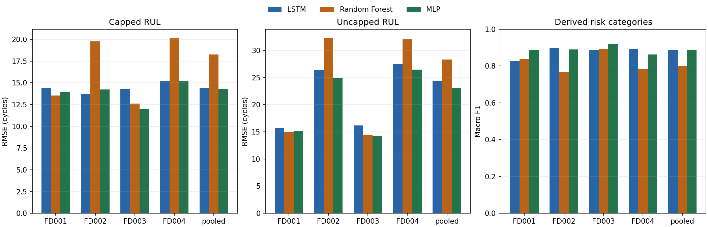


**Why serve LSTM when MLP has lower pooled RMSE?** MLP is the strongest model here on pooled RMSE and slightly on risk macro F1. LSTM has the lowest pooled capped MAE, directly processes ordered telemetry, and already integrates MC dropout and interval calibration into the serving path. It also has the lowest uncapped NASA penalty (14,368.65 versus MLP's 14,583.20). This is a deployment choice for the temporal demonstration, not evidence that LSTM universally outperforms the alternatives.

| Model | Strength | Limitation |
| --- | --- | --- |
| Random Forest | Nonlinear baseline with impurity-based feature importance; no feature standardization needed | Highest pooled errors; window summaries compress temporal detail; feature importance is not causal |
| MLP | Lowest pooled RMSE with compact statistical inputs | Six statistics per channel discard much of the sequence order; no calibrated interval implementation in this project |
| LSTM | Learns from ordered sequences; lowest capped MAE; integrated uncertainty path | Slightly higher RMSE than MLP; interval quality depends on calibration and target definition |

<details>
<summary>Training measurements and per-subset RMSE</summary>

| Model | Recorded training time | Device | Timing scope | Validation RMSE |
| --- | ---: | --- | --- | ---: |
| Random Forest | 144.2 s | CPU | Fit only | 19.657 |
| MLP | 23.3 s | CPU | Scaling, fit and validation selection | 14.592 |
| LSTM | 164.3 s | CUDA | Training loop, including validation | 14.677 |

These are measurements of one pooled fit per model. **They are not directly comparable speed benchmarks:** hardware, execution paths and timing scopes differ; feature preparation is recorded separately. Validation RMSE uses overlapping windows from held-out engines, while test metrics use one endpoint per engine.

| Subset | Random Forest capped RMSE | MLP capped RMSE | LSTM capped RMSE |
| --- | ---: | ---: | ---: |
| FD001 | 13.548 | 13.978 | 14.388 |
| FD002 | 19.745 | 14.230 | 13.697 |
| FD003 | 12.603 | 11.957 | 14.324 |
| FD004 | 20.150 | 15.233 | 15.236 |

The executed [model comparison notebook](notebooks/AeroGuard_Model_Comparison.ipynb) contains full capped/uncapped regression, classification and timing tables.

</details>

## Problem statement

Predictive maintenance uses degradation patterns to estimate when equipment may need attention. RUL is the number of operating cycles remaining before the simulated failure endpoint. Estimating it from recent engine settings and sensor measurements illustrates how maintenance planning can use condition information.

**C-MAPSS contains simulated turbofan engine telemetry, not live commercial aircraft telemetry.** The dashboard's engine identities represent benchmark trajectories, and its updates are local inference requests rather than an aircraft data feed. [NASA describes the simulation dataset here.](https://www.nasa.gov/intelligent-systems-division/discovery-and-systems-health/pcoe/pcoe-data-set-repository/)

## Dataset and preprocessing

Each observation has an engine identifier, a cycle index, **three operating settings and 21 sensor channels**: 26 file columns, of which 24 are model inputs. Engine identifiers and cycle indices are not predictor channels. FD001/FD002 simulate high-pressure compressor (HPC) degradation; FD003/FD004 include HPC and fan degradation.

| Subset | Operating conditions | Fault modes | Available training engines | Fit engines | Validation engines | Test engines | Train rows | Test rows |
| --- | ---: | ---: | ---: | ---: | ---: | ---: | ---: | ---: |
| FD001 | 1 | 1 | 100 | 79 | 21 | 100 | 20,631 | 13,096 |
| FD002 | 6 | 1 | 260 | 207 | 53 | 259 | 53,759 | 33,991 |
| FD003 | 1 | 2 | 100 | 77 | 23 | 100 | 24,720 | 16,596 |
| FD004 | 6 | 2 | 249 | 204 | 45 | 248 | 61,249 | 41,214 |
| Total | — | — | **709** | **567** | **142** | **707** | **160,359** | **104,897** |

Counts are checked against the actual files and saved split. The distributed `readme.txt` swaps FD004's train/test counts; the data files and 248-entry test RUL vector establish the counts above. The download script checks dimensions, finite values, duplicate engine/cycle keys, consecutive cycle ordering and label alignment, then writes a local `data/dataset_audit.json` with input hashes and distributions.

The saved protocol pools all four training subsets after offsetting engine IDs, then makes one seeded 80/20 engine split (`seed=42`). No engine appears in both fit and validation groups. This produces **99,714 training windows** and **25,904 validation windows**. All three models reuse this split.

Training RUL is `final training cycle − current cycle`, capped at **125 cycles** for both fit and validation. Each window contains 50 ordered cycles from one engine and takes the final cycle's label. The LSTM scaler is fitted only to training windows. The MLP separately scales its statistical features and targets using training data only. The Random Forest uses unscaled statistical inputs.

Each test engine uses its final 50 observed cycles and the corresponding official NASA terminal RUL. Short histories are left-padded with the first observation. Capped and uncapped evaluation use the same point predictions; **150/707** test labels exceed the training cap.

## End-to-end ML workflow

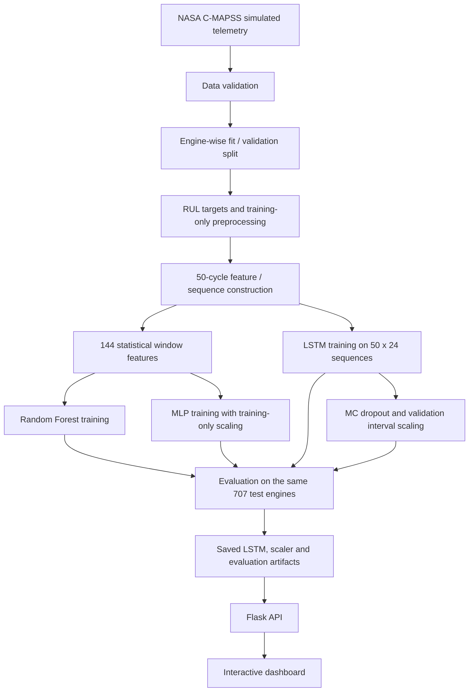

Random Forest and MLP are comparison artifacts. The Flask prediction endpoints serve LSTM.

## Model architectures

**Random Forest Regressor.** Each of the 24 channels contributes mean, population standard deviation, minimum, maximum, latest value and least-squares slope across the window: **144 features**. The forest uses 96 trees, maximum depth 17, a six-sample minimum leaf, `max_features=0.5`, bootstrap sampling with `max_samples=0.85`, four CPU workers and seed 42.

**Multi-Layer Perceptron.** The same 144 features feed two hidden layers of **128 and 64 ReLU units** and a scalar regression output. Training uses scikit-learn's Adam, learning rate 0.001, L2 regularization `alpha=0.001`, batch size 512 and shuffled incremental epochs. Feature and RUL standardization use training-only statistics. A custom validation loop selects epoch **37 of 49 executed**, with a 100-epoch maximum and patience 12; scikit-learn's internal `early_stopping` is disabled.

**Long Short-Term Memory network.** A **50 × 24** sequence enters **two 64-unit LSTM layers**, with dropout probability 0.2 between layers and a 0.2 dropout layer on the last timestep, followed by **one linear output in cycles**. There is no Softmax or [0, 1] probability output. Adam starts at 0.001 with weight decay 0.00001, batch size 256 and gradient norm clipping at 1. Learning rate halves after two validation plateaus. The run has a 20-epoch budget and patience 5; validation selects **epoch 15**, with RMSE **14.677 cycles**. Target standardization uses training-only statistics; the inverse transform is folded into the saved linear head for serving.

Architecture and hyperparameters are recorded in [model.py](src/model.py), [train.py](src/train.py), [classical_baselines.py](src/classical_baselines.py) and the saved evaluation configurations. One configuration was fitted for each classical baseline; this is not an exhaustive tuning study.

## Evaluation and explainability

**Regression metrics:** RMSE gives greater weight to large errors; MAE is mean absolute error, both in cycles. R² describes explained variance relative to a constant-mean reference. The NASA asymmetric score sums exponential penalties and penalizes RUL overestimates more heavily than equal-sized underestimates; lower is better, and totals depend on cohort size.

**Derived classification metrics:** precision measures how often a predicted risk category is correct; recall measures how many actual members of that category are recovered. F1 balances precision and recall. Macro averages weight categories equally; weighted averages use category support. The LSTM's pooled macro precision is **89.25%**, macro recall **88.01%**, macro F1 **88.61%**, and weighted F1 **92.30%**. These values must not be called RUL regression accuracy.

| LSTM cohort | Engines | Capped RMSE | Capped MAE | Capped R² | Uncapped RMSE | Uncapped MAE | Capped NASA score |
| --- | ---: | ---: | ---: | ---: | ---: | ---: | ---: |
| FD001 | 100 | 14.388 | 10.469 | 0.8711 | 15.770 | 11.539 | 309.50 |
| FD002 | 259 | 13.697 | 9.623 | 0.8982 | 26.396 | 17.110 | 881.92 |
| FD003 | 100 | 14.324 | 9.916 | 0.8663 | 16.153 | 11.471 | 938.22 |
| FD004 | 248 | 15.236 | 10.895 | 0.8743 | 27.536 | 19.456 | 1,023.77 |
| Pooled | **707** | **14.438** | **10.230** | **0.8823** | **24.358** | **16.347** | **3,153.40** |

The [LSTM evaluation JSON](models/current/evaluation.json) includes uncapped R², NASA scores, residual quantiles, per-class results and interval diagnostics. [Engine-level predictions](models/current/test_predictions.csv) support independent metric calculations. Dashboard summary cards primarily use **FD001** metrics; they should not be read as pooled results.

<details>
<summary>Learning curves, feature importance and prediction diagnostics</summary>


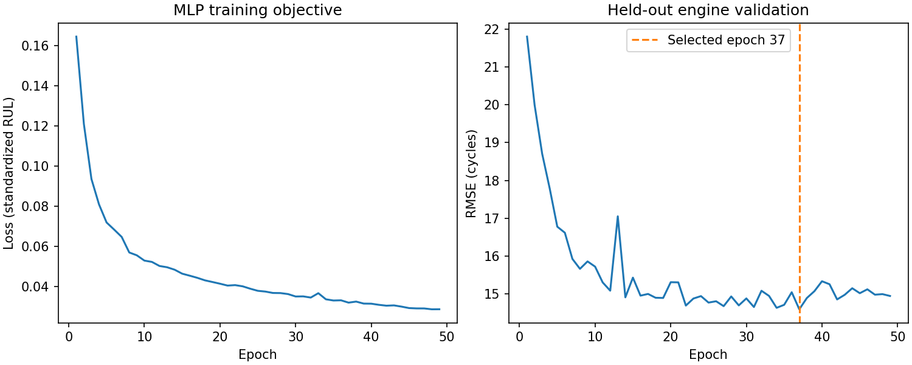

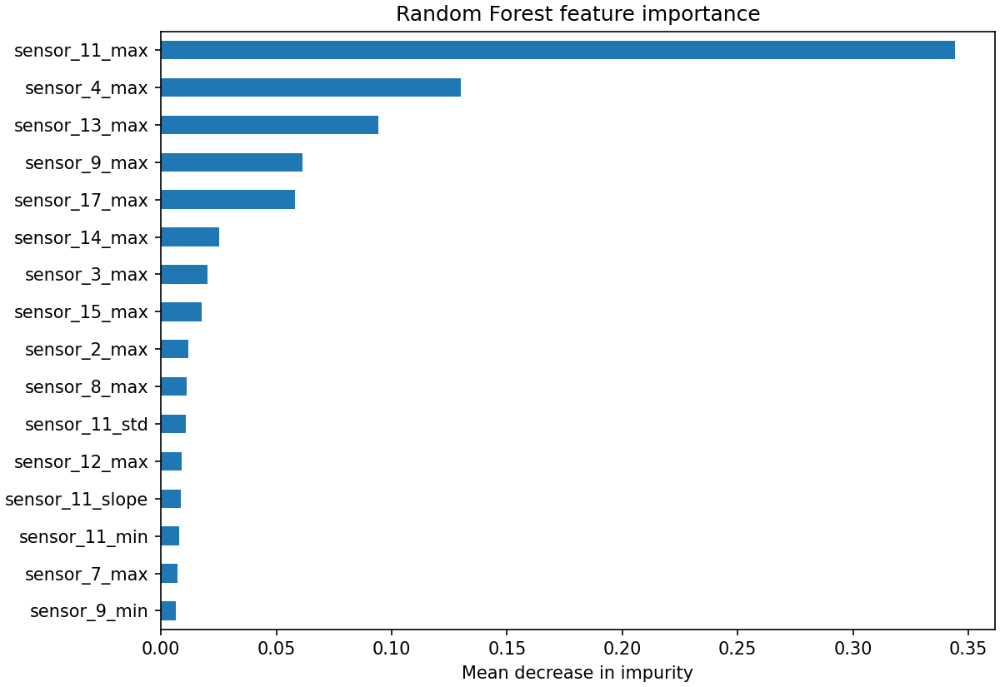

Impurity importance describes the fitted forest. Correlated channels and summaries can share or distort importance; this is not causal evidence. The dashboard uses integrated gradients only when optional Captum is available; otherwise it labels its sensor–RUL correlation fallback. Neither explains an intervention's effect.

| FD001 | FD002 |
| --- | --- |
| 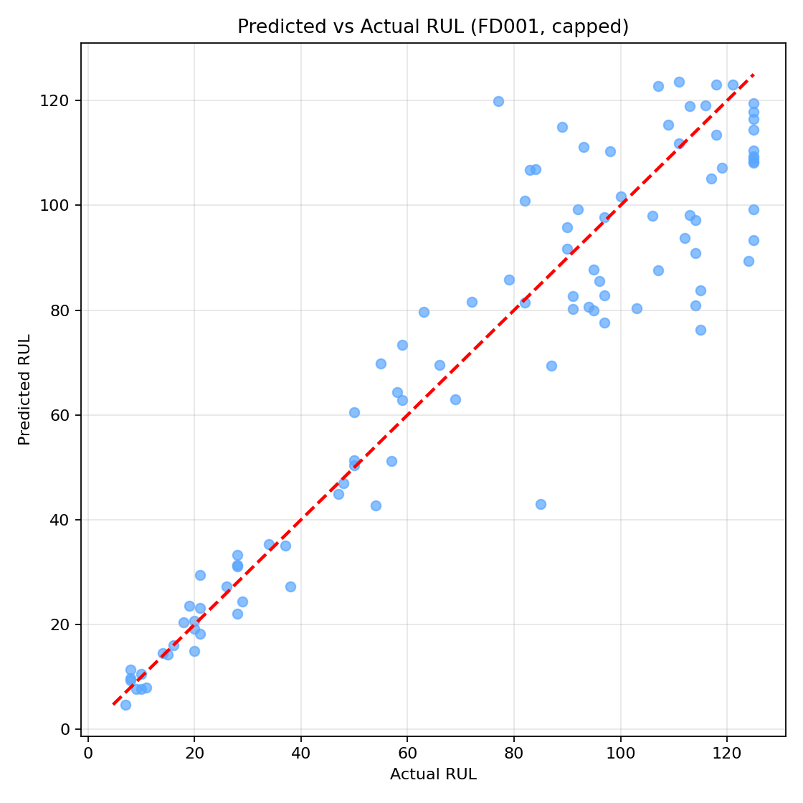 | 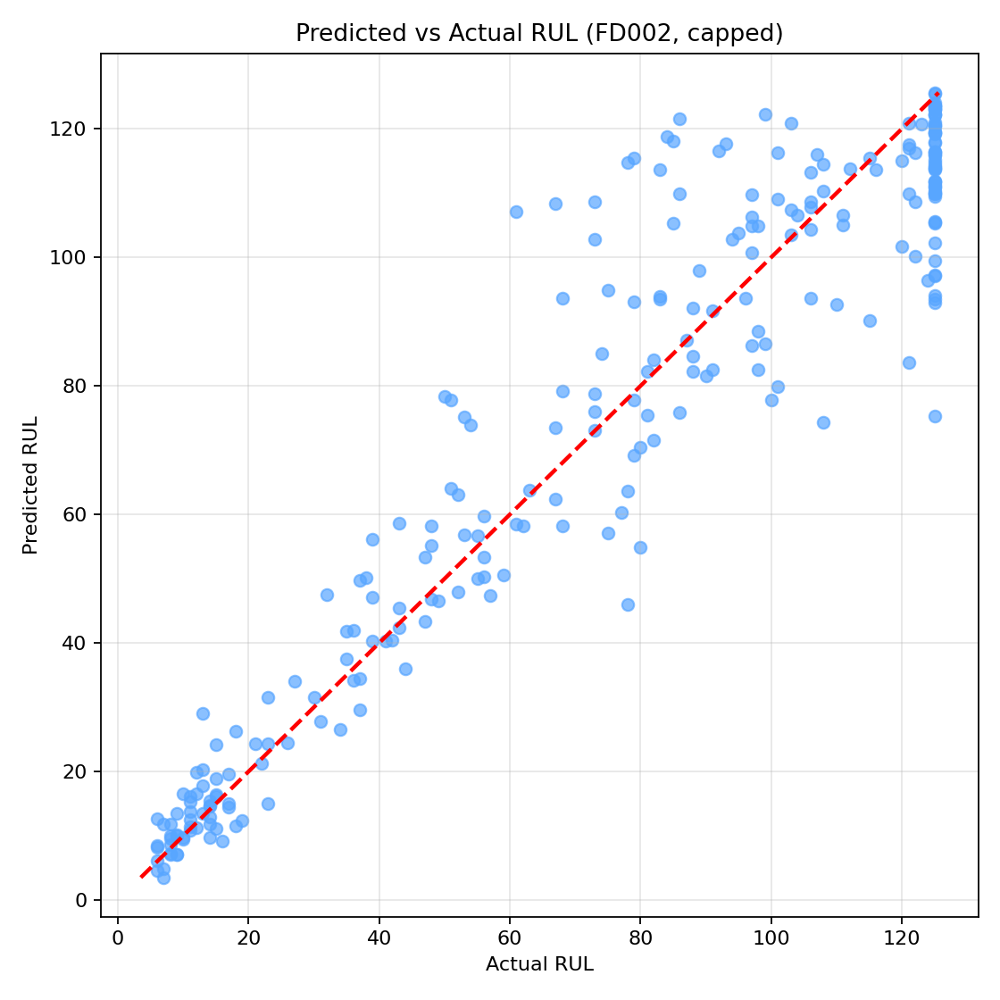 |
| FD003 | FD004 |
|  |  |

The following existing outputs were extracted from the executed [EDA notebook](notebooks/AEROPREDICT_EDA.ipynb), without rerunning training:

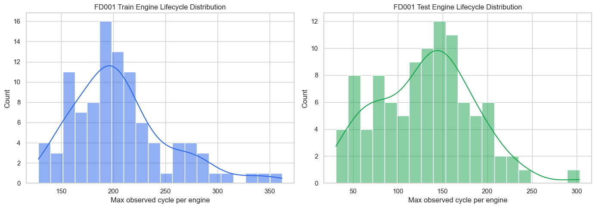

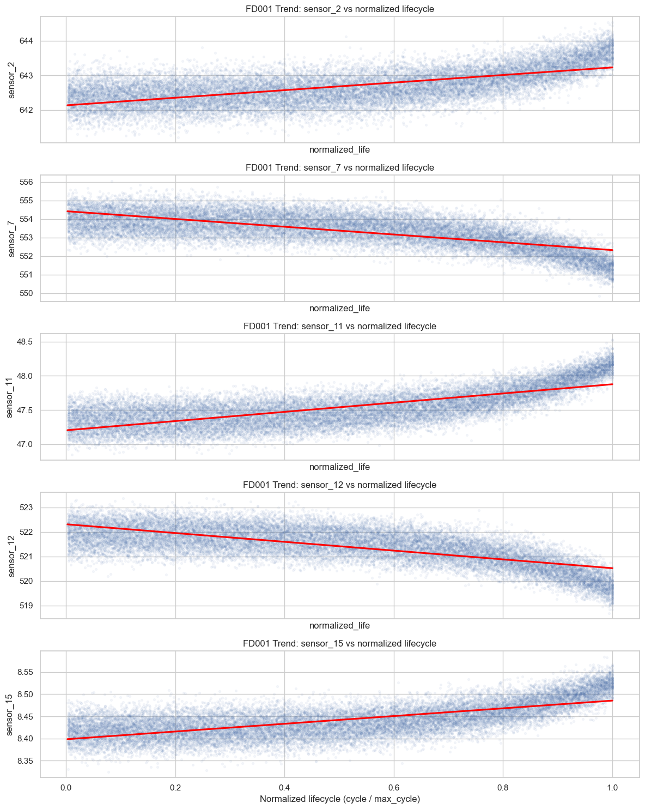

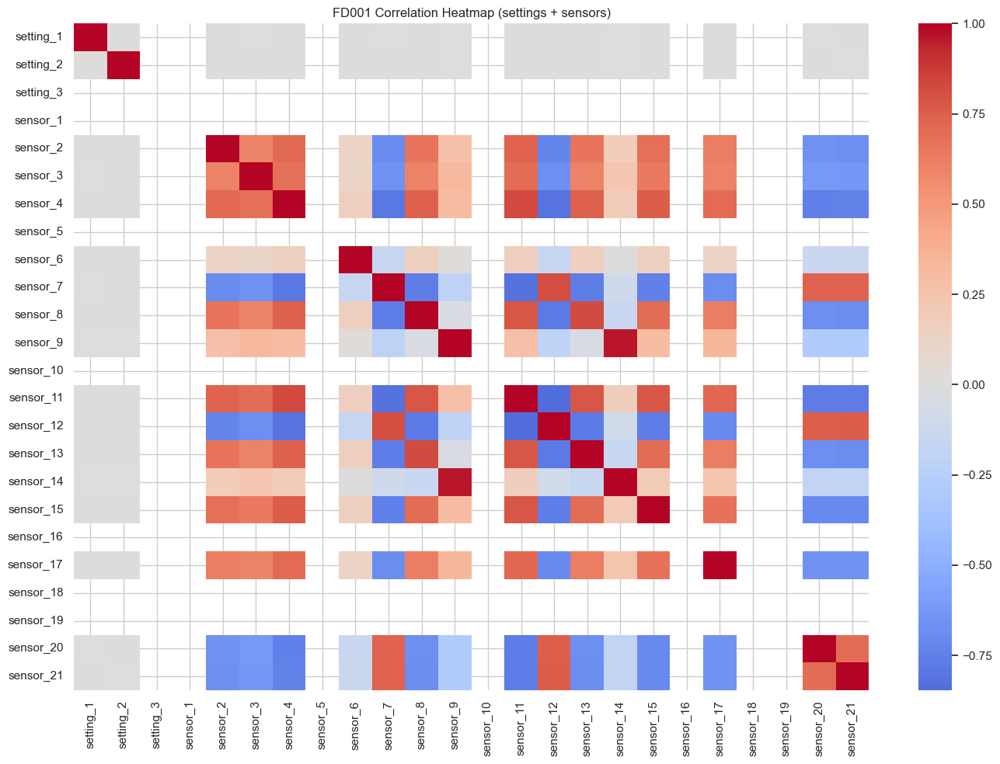

</details>

### Empirical uncertainty calibration

The point prediction uses evaluation mode. Uncertainty uses **100 MC dropout draws** and their mean and population standard deviation. The raw interval is `MC mean ± 1.645 × MC SD`, with bounds clipped at zero. Validation scaling uses one seeded randomly truncated endpoint from each of the **142 held-out validation engines**, and an empirical quantile of `absolute residual / max(MC SD, 1 cycle)`. Separate multipliers are fitted for capped and uncapped labels; the API serves the capped calibration.

| Target | Raw coverage | Raw mean width | Validation-scaled coverage | Scaled mean width |
| --- | ---: | ---: | ---: | ---: |
| Capped | 45.40% | 12.14 cycles | 91.09% | 55.41 cycles |
| Uncapped | 38.47% | 12.14 cycles | 100.00% | 201.26 cycles |

These are **observed test coverages**, not guaranteed confidence. Validation engines also select the checkpoint; their sampled endpoints differ from NASA's test truncation process. The wide uncapped intervals limit practical usefulness, and aggregate coverage can hide near-failure or subgroup errors. A 90% target is not a safety assurance.

## Dashboard gallery

All images use repository-relative paths. Prediction examples show the saved LSTM on simulated benchmark engines. MC interval bounds and request timings vary between executions. Incorrect architecture and infrastructure labels in supplied screenshots were replaced with verified browser captures; see [asset provenance](docs/assets.md).

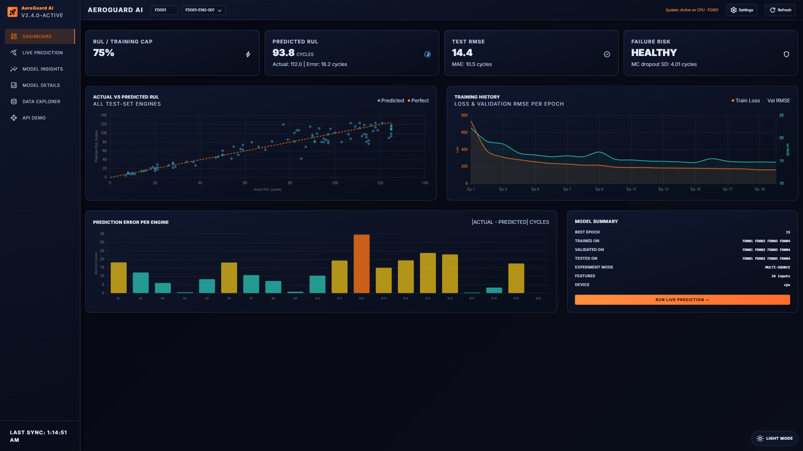

*Main dashboard: FD001 overview. RUL divided by the training cap is a display ratio, not a measured engine health probability.*

<details>
<summary>Healthy, warning and critical prediction examples</summary>

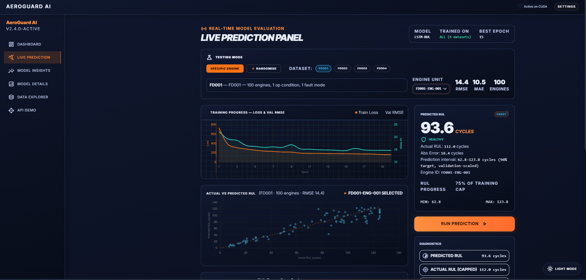

*Healthy: FD001 engine 1, predicted RUL 93.6 cycles, with a validation-scaled interval.*


*Warning: FD002 engine 17, predicted RUL 58.0 cycles. The actual 68-cycle label illustrates that a predicted category can differ from ground truth.*


*Critical: FD001 engine 90, predicted RUL 22.0 cycles against an actual 28-cycle endpoint.*

</details>

<details>
<summary>Model insights, architecture, API demonstration and data explorer</summary>


*Model insights: measured error diagnostics, a 64-dimensional latent state and labelled feature attribution method.*

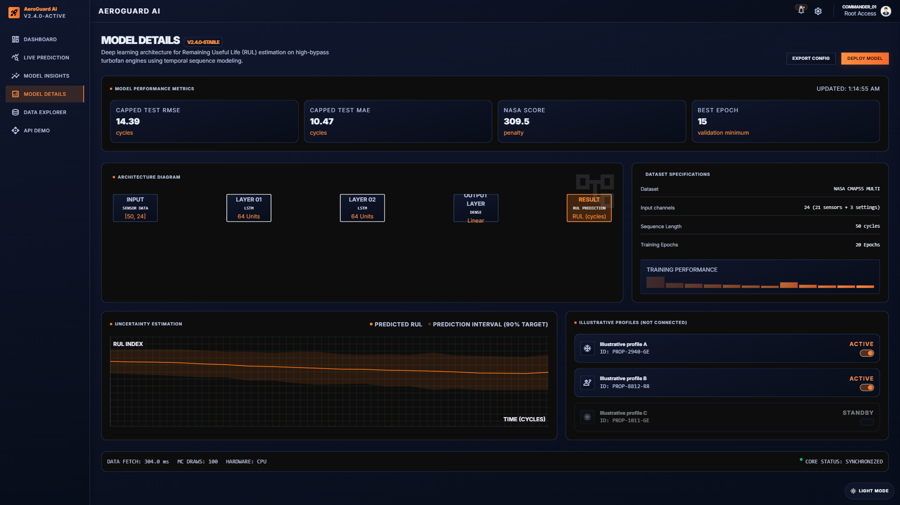

*Model details: 24 input channels, two 64-unit LSTM layers and a linear RUL output. Illustrative profile cards are not connected commercial engine integrations.*

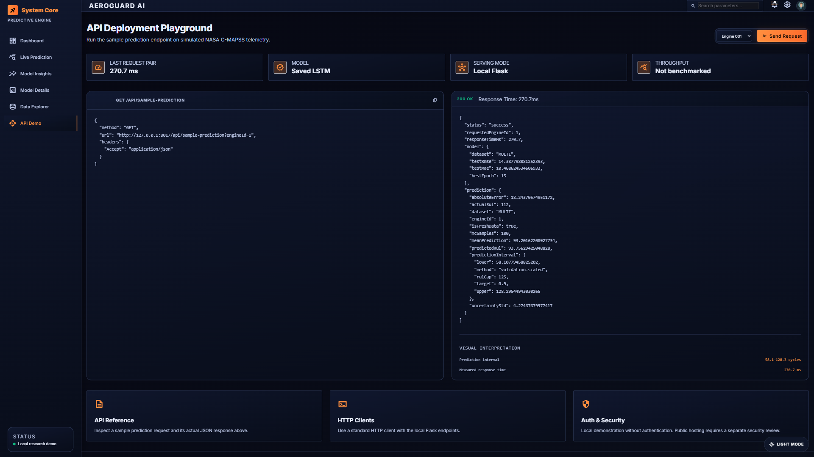

*API demonstration: a real local response and measured request-pair time; throughput has not been benchmarked.*

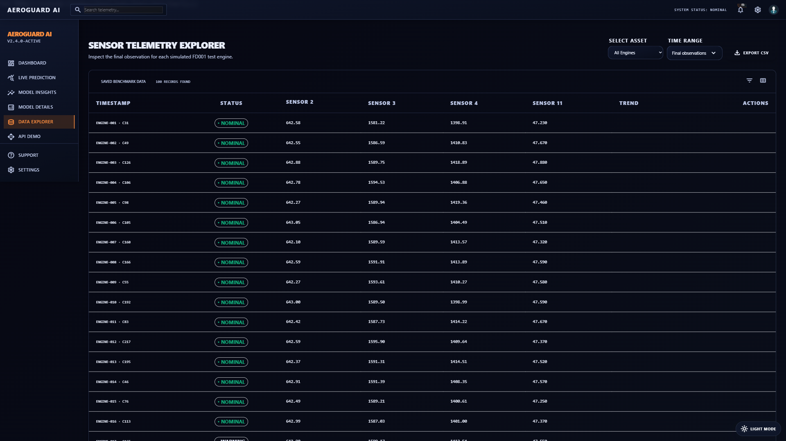

*Data explorer: final observations from simulated FD001 test engines, with filtering, pagination and CSV export.*

</details>

## Technology stack

| Area | Technologies |
| --- | --- |
| ML and analysis | Python 3.11, PyTorch, scikit-learn, Pandas, NumPy, Matplotlib, Seaborn, Jupyter |
| API | Flask, Flask-CORS, Requests for dataset download |
| Dashboard | JavaScript, HTML, CSS, bundled Tailwind CSS and Chart.js 4.4.0 |
| Verification | Python unittest; optional Playwright with Microsoft Edge |

Python dependencies are pinned in [requirements.txt](requirements.txt). Node.js and an npm build are not required to run the dashboard. Captum is optional and is not installed by the default requirements.

## Repository structure

```text
.
├── aerospace-dashboard/          # Dashboard pages, scripts, styles and vendor notice
├── docs/
│   ├── final-screenshots/        # Verified dashboard gallery
│   ├── ml-results/               # Copies/extractions of existing ML figures
│   ├── dashboard-shots/          # Historical upstream layout screenshots
│   ├── assets.md                 # Asset provenance and screenshot exclusions
│   └── model-checksums.sha256    # Preserved model and scaler hashes
├── models/
│   ├── current/                  # Served LSTM, scaler, evaluation and history
│   ├── comparative/              # Random Forest, MLP and common evaluation
│   └── ...                       # Preserved original checkpoint, scaler and plots
├── notebooks/
│   ├── AEROPREDICT_EDA.ipynb      # Executed EDA and LSTM evaluation
│   └── AeroGuard_Model_Comparison.ipynb
├── src/                          # Download, preprocessing, training, evaluation, API
├── tests/                        # Workflow integration and browser smoke checks
├── scratch/inspect_checkpoint.py  # Portable inspection of the original checkpoint
├── requirements.txt
├── package.json                  # Repository metadata; no frontend build needed
├── run_pipeline.sh / .cmd         # Full pipeline: includes training
└── test_environment.sh / .cmd
```

Raw downloadable datasets, local environments, caches and experimental runs are ignored. Original scientific artifacts and third-party notices are retained.

## Installation and execution

Use **Python 3.11** and run commands from the repository root. The committed checkpoint and scaler are sufficient for the model; the dashboard also needs the downloaded NASA data.

```bash
git clone https://github.com/GargCodesT18/AeroGuard-AI.git
cd AeroGuard-AI
python -m venv .venv
```

Activate the environment on your platform:

```bash
# Linux / macOS
source .venv/bin/activate
```

```powershell
# Windows PowerShell
.\.venv\Scripts\Activate.ps1
```

Install dependencies, download/validate the dataset, and start the saved-model app:

```bash
python -m pip install -r requirements.txt
python src/download_data.py
python src/api_server.py --port 8000
```

Open **[http://127.0.0.1:8000/](http://127.0.0.1:8000/)**. If the port is in use, choose another with `--port` and use the same port in the browser. Flask binds to localhost with debug disabled. The API selects `models/current/`; it falls back to original `models/` artifacts if the current checkpoint is absent.

The default PyTorch installation supports CPU inference. For CUDA, install the appropriate official wheel before the remaining requirements; consult [PyTorch's installation instructions](https://docs.pytorch.org/get-started/previous-versions/). A CUDA GPU is optional for serving. The local verification used Python 3.11, PyTorch 2.11.0 and scikit-learn 1.7.2; the original scaler was serialized with scikit-learn 1.6.1.

### Optional training and evaluation

These commands are documented for reproduction; **no model was retrained during the publication audit**. Evaluation writes to a separate directory so saved results remain intact:

```bash
python src/evaluate.py --dataset ALL --checkpoint models/current/lstm_rul.pth --output-dir models/recheck --mc-samples 100
```

To train a separate LSTM with the saved run's options (potentially slow on CPU):

```bash
python src/train.py --epochs 20 --patience 5 --batch-size 256 --standardize-target --schedule --clip-grad 1 --validation-only --output-dir models/reproduction
python src/evaluate.py --dataset ALL --checkpoint models/reproduction/lstm_rul.pth --output-dir models/reproduction-evaluation --mc-samples 100
```

Add `--require-cuda` to training to require a supported GPU. The full pipeline launchers include training and write to `models/current/`; they are not needed to launch the saved-model application.

The classical baseline script has no argument parser and writes to `models/comparative/`. Run it only in a separate disposable clone if you intend to replace those comparison artifacts:

```bash
python src/classical_baselines.py
```

Open the preserved executed notebooks for analysis:

```bash
python -m jupyter notebook notebooks/AEROPREDICT_EDA.ipynb
```

### Tests

With the dataset downloaded, the existing workflow tests check NASA terminal label alignment, short-history padding, API/offline metric agreement, raw-sequence inference, interval responses and risk boundaries:

```bash
python -m unittest discover -s tests -v
```

For CPU-only verification with a CUDA build, set `CUDA_VISIBLE_DEVICES=-1` before running Python:

```powershell
$env:CUDA_VISIBLE_DEVICES = '-1'
python -m unittest discover -s tests -v
Remove-Item Env:CUDA_VISIBLE_DEVICES
```

```bash
CUDA_VISIBLE_DEVICES=-1 python -m unittest discover -s tests -v
```

Optional browser checks require Playwright and an installed Microsoft Edge. Start Flask in another terminal on port 8000, then run:

```bash
python -m pip install playwright
python tests/browser_smoke.py
```

For another port, set `AEROGUARD_TEST_URL` to its localhost URL. Browser checks cover all seven pages and all four prediction subsets, including architecture labels and real API response timing. A clean-environment installation on another operating system has not been verified.

### API entry points

| Request | Purpose |
| --- | --- |
| `GET /api/summary` | Saved configuration, primary-subset metrics and data counts |
| `GET /api/history` | Training history |
| `GET /api/sample-prediction?dataset=FD001&engineId=1` | One benchmark engine prediction and interval |
| `GET /api/all-predictions?dataset=FD001` | Dataset point predictions |
| `GET /api/engine-ids?dataset=FD001` | Available engine IDs |
| `GET /api/engine-history?dataset=FD001&engineId=1` | Engine sensor and RUL histories |
| `GET /api/explorer?dataset=FD001` | Final test observations |
| `GET /api/notifications?dataset=FD001` | Illustrative threshold-based notifications |
| `POST /api/predict` | Ordered raw telemetry sequence, optional dataset and MC draw count |

Sequence columns follow the saved `feature_columns` order: settings 1–3, then sensors 1–21. Use the local demo to inspect the actual JSON contract. Load only trusted model/scaler artifacts; pickle and joblib are executable serialization formats.

## Limitations

- Simulated C-MAPSS trajectories do not establish performance on live aircraft, specific commercial engine types or new operating distributions.
- A 125-cycle training cap suppresses early-life target detail. Capped and uncapped scores answer different questions and must be labelled separately.
- The comparison uses a single seeded engine split and one configuration per classical model. Overlapping validation windows are correlated; pooled results reflect unequal subset sizes.
- Empirical interval coverage is not guaranteed confidence. Calibration shares validation engines with model selection and uncapped intervals are very wide.
- Risk thresholds and the RUL/cap display ratio are illustrative; neither is a validated maintenance policy or a calibrated failure probability.
- This is a local Flask research app with permissive CORS, no authentication and no production load benchmark. External font/avatar requests in inherited dashboard pages may contact third-party services. Public hosting requires a separate deployment/security review.
- Prior project documentation records a native Windows CUDA/cuDNN teardown failure after artifact export. This audit uses CPU for repeatable automated verification; it does not revalidate CUDA training.
- Redistribution permission for inherited code and assets must be verified before publication.

## Attribution and references

The inherited **AEROPREDICT** codebase and dashboard are credited to **Kunwarpreet Singh (`kunwar1908`), `DevAriwala2712` and Team No Signal**. The baseline is commit [`23efd614884e04ace31fcf338157bc1c6b982711`](https://github.com/kunwar1908/AEROPREDICT/commit/23efd614884e04ace31fcf338157bc1c6b982711), from the [upstream repository](https://github.com/kunwar1908/AEROPREDICT), itself a fork of [DevAriwala2712/AEROPREDICT](https://github.com/DevAriwala2712/AEROPREDICT).

AeroGuard improvements include validated four-subset data loading, consistent training-only scaling, reproducible training options, saved engine splits, capped/uncapped evaluation, derived risk metrics, empirical interval scaling, Random Forest/MLP comparisons, executed analysis notebooks and corrected dashboard measurements. This publication includes portable documentation and verified asset organization. Original components and contributions remain attributed.

**Licensing status:** no repository-wide LICENSE or explicit redistribution permission was established for the inherited source. Both upstream repositories report no detected license. The inherited `package.json` contained `ISC`, without a corresponding license text or established repository-wide scope; that unsupported claim has been removed from this fork's metadata. Obtain permission or a clear applicable upstream license before redistribution. [GitHub explains the effect of absent licensing.](https://docs.github.com/en/repositories/managing-your-repositorys-settings-and-features/customizing-your-repository/licensing-a-repository)

The bundled Chart.js notice is preserved in [chart.js.LICENSE.md](aerospace-dashboard/chart.js.LICENSE.md). It applies to that vendor component and does not license the rest of the project.

- A. Saxena and K. Goebel (2008), *Turbofan Engine Degradation Simulation Data Set*, NASA Prognostics Data Repository: [NASA PCoE dataset catalog](https://www.nasa.gov/intelligent-systems-division/discovery-and-systems-health/pcoe/pcoe-data-set-repository/).
- A. Saxena, K. Goebel, D. Simon and N. Eklund (2008), *Damage Propagation Modeling for Aircraft Engine Prognostics*: [NASA technical report](https://ntrs.nasa.gov/citations/20090029214).
- Y. Gal and Z. Ghahramani (2016), *Dropout as a Bayesian Approximation*: [ICML paper](https://proceedings.mlr.press/v48/gal16.html). This motivates MC dropout; it does not confer guaranteed coverage on this implementation.

Model and scaler integrity hashes are recorded in [model-checksums.sha256](docs/model-checksums.sha256).
