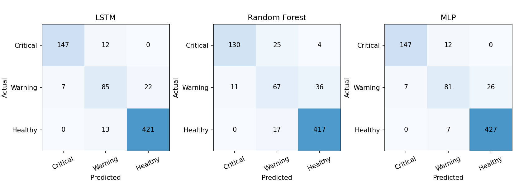
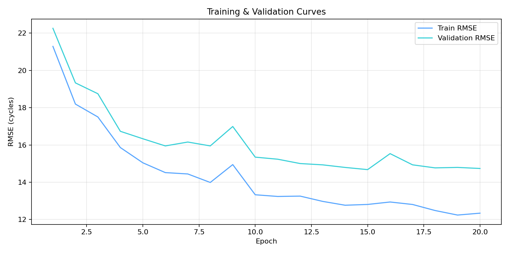
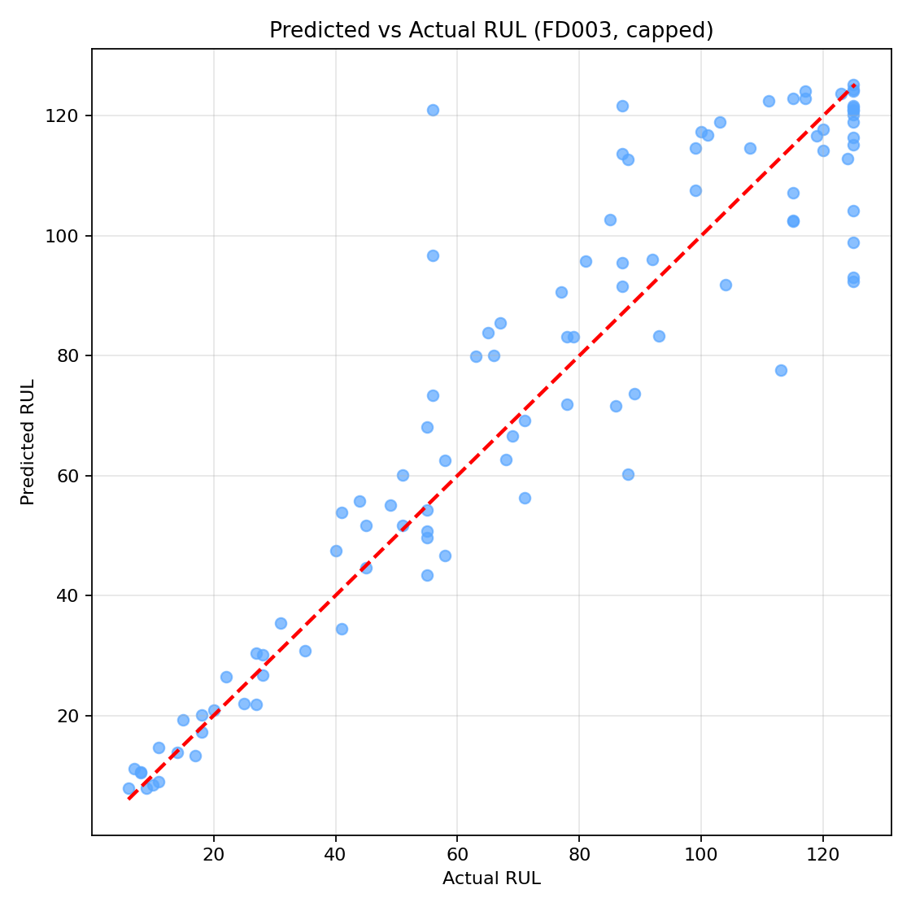
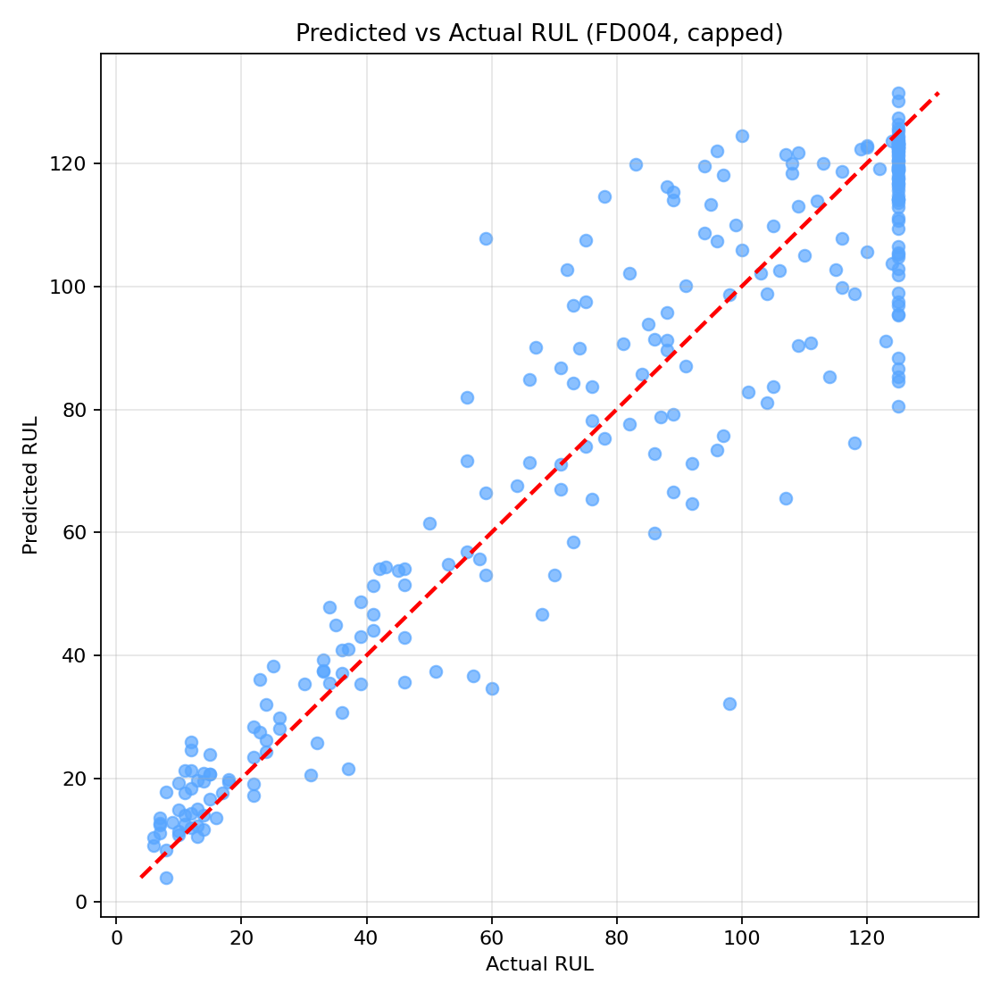
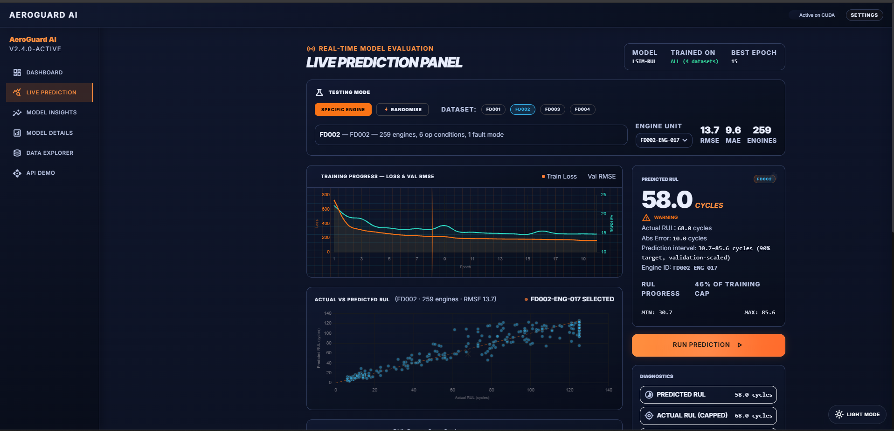
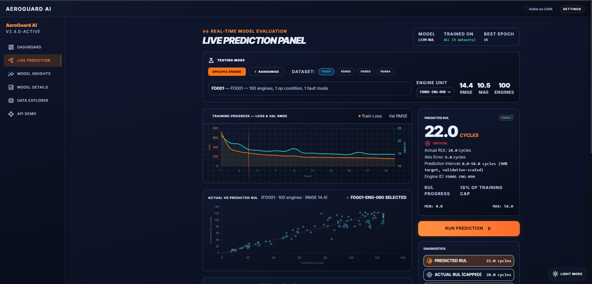
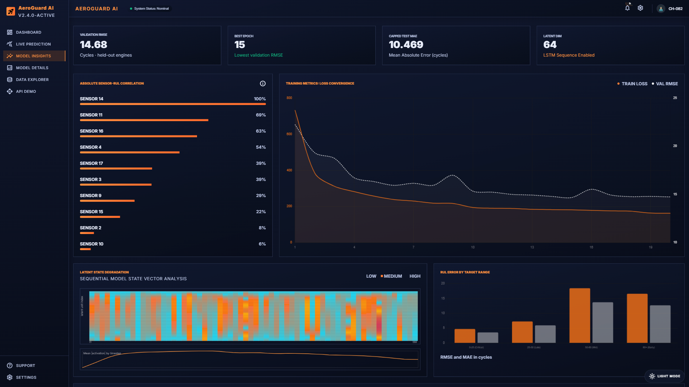

# AeroGuard AI

**Aircraft engine predictive maintenance · UML501 Machine Learning course project**

AeroGuard AI estimates **Remaining Useful Life (RUL)** from NASA C-MAPSS simulated turbofan telemetry. It compares Random Forest, MLP and LSTM regression models, with a local Flask backend and dashboard for exploring the saved LSTM.

**3 trained models · 707 held-out test engines · 92.36% LSTM risk classification accuracy (653/707)**

RUL measures operating cycles remaining before the simulated failure endpoint. This educational project studies degradation patterns for condition-based maintenance; its predictions and illustrative risk labels are not certified for aviation maintenance decisions. C-MAPSS is simulated telemetry, not a live aircraft feed.

[Model comparison](#model-comparison) · [Dataset and methodology](#dataset-and-methodology) · [Local setup](#local-setup)

## Model comparison

Each test engine contributes one terminal-window prediction. The same predictions are scored against capped labels, `min(NASA RUL, 125)`, and original uncapped NASA labels. Values below come from the saved [comparison CSV](models/comparative/comparison.csv) and [detailed evaluation](models/comparative/evaluation.json); lower RMSE and MAE are better.

| Model | Capped RMSE ↓ | Capped MAE ↓ | Capped R² ↑ | Uncapped RMSE ↓ | Uncapped MAE ↓ | Risk accuracy ↑ | Risk macro F1 ↑ |
| --- | ---: | ---: | ---: | ---: | ---: | ---: | ---: |
| Random Forest | 18.267 | 13.752 | 0.8116 | 28.335 | 19.919 | 86.85% | 80.12% |
| MLP | **14.263** | 10.460 | **0.8851** | **23.107** | **15.871** | **92.64%** | **88.64%** |
| LSTM (local inference) | 14.438 | **10.230** | 0.8823 | 24.358 | 16.347 | 92.36% | 88.61% |

RMSE and MAE are measured in cycles. Risk accuracy and F1 measure **categories derived from RUL**, not regression accuracy. Critical is RUL ≤30 cycles, Warning is 30 < RUL ≤60, and Healthy is RUL >60. These illustrative thresholds have no aviation safety validation.

<a href="docs/ml-results/model-comparison.png"></a>

*Model comparison: the same 707 test engines, with capped and uncapped targets reported separately.*

<a href="docs/ml-results/confusion-matrices.png"></a>

*Derived risk categories: LSTM correctly classifies 653 of 707 engines (92.36%). These are thresholded RUL predictions, not a separately trained classifier.*

**Why does MLP win on RMSE while LSTM wins on capped MAE?** RMSE squares residuals, giving large errors more influence; MAE weights absolute errors linearly. MLP’s lower pooled RMSE (14.263 versus 14.438 cycles) indicates a lower mean squared error, while LSTM’s lower capped MAE (10.230 versus 10.460 cycles) indicates a smaller mean absolute error. The error distributions therefore favor different metrics; MAE alone does not show that LSTM is better for every engine.

MLP also has the best pooled risk accuracy and slightly higher macro F1. The local backend uses LSTM to demonstrate ordered telemetry modelling, MC dropout and validation-scaled intervals. LSTM has the lowest uncapped NASA penalty (**14,368.65**, versus MLP’s **14,583.20**), which weights overestimates more heavily. This choice does not establish universal LSTM superiority.

| Model | Strength | Limitation |
| --- | --- | --- |
| Random Forest | Nonlinear baseline with impurity-based feature importance; no feature standardization needed | Highest pooled errors; window summaries compress temporal detail; feature importance is not causal |
| MLP | Lowest pooled RMSE with compact statistical inputs | Six statistics per channel discard much of the sequence order; no calibrated interval implementation in this project |
| LSTM | Learns from ordered sequences; lowest capped MAE; integrated uncertainty path | Slightly higher RMSE than MLP; interval quality depends on calibration and target definition |

### Training curves and feature importance

<a href="docs/ml-results/lstm-learning-curves.png"></a>

*LSTM: validation selects epoch 15 with RMSE 14.677 cycles.*

<a href="docs/ml-results/mlp-learning-curves.png"></a>

*MLP: epoch 37 is selected from 49 executed epochs; validation RMSE is 14.592 cycles.*

<a href="docs/ml-results/random-forest-feature-importance.png"></a>

*Random Forest: impurity importance describes the fitted model. Correlated channels and summaries can share or distort importance; it is not causal evidence.*

### RUL prediction results

<a href="docs/ml-results/lstm-actual-vs-predicted-fd001.png"></a>

*FD001: one terminal-window prediction per engine, scored against RUL capped at 125 cycles.*

<details>
<summary>Full-width RUL plots for FD002, FD003 and FD004</summary>

<a href="docs/ml-results/lstm-actual-vs-predicted-fd002.png"></a>

*FD002: 259 held-out test engines.*

<a href="docs/ml-results/lstm-actual-vs-predicted-fd003.png"></a>

*FD003: 100 held-out test engines.*

<a href="docs/ml-results/lstm-actual-vs-predicted-fd004.png"></a>

*FD004: 248 held-out test engines.*

</details>

## Dataset and methodology

Each observation has an engine identifier, a cycle index, **three operating settings and 21 sensor channels**: 26 file columns, of which 24 are model inputs. Engine identifiers and cycle indices are not predictor channels. FD001/FD002 simulate high-pressure compressor (HPC) degradation; FD003/FD004 include HPC and fan degradation.

| Subset | Operating conditions | Fault modes | Available training engines | Fit engines | Validation engines | Test engines | Train rows | Test rows |
| --- | ---: | ---: | ---: | ---: | ---: | ---: | ---: | ---: |
| FD001 | 1 | 1 | 100 | 79 | 21 | 100 | 20,631 | 13,096 |
| FD002 | 6 | 1 | 260 | 207 | 53 | 259 | 53,759 | 33,991 |
| FD003 | 1 | 2 | 100 | 77 | 23 | 100 | 24,720 | 16,596 |
| FD004 | 6 | 2 | 249 | 204 | 45 | 248 | 61,249 | 41,214 |
| Total | — | — | **709** | **567** | **142** | **707** | **160,359** | **104,897** |

Counts follow the audited data files and saved split. The distributed `readme.txt` swaps FD004's train/test counts; the data files and 248-entry test RUL vector establish the counts above. The download script checks dimensions, finite values, duplicate engine/cycle keys, consecutive cycle ordering and label alignment, then writes a local `data/dataset_audit.json` with input hashes and distributions.

The saved protocol pools all four training subsets after offsetting engine IDs, then makes one seeded 80/20 engine split (`seed=42`). No engine appears in both fit and validation groups. This produces **99,714 training windows** and **25,904 validation windows**. All three models reuse this split.

Training RUL is `final training cycle − current cycle`, capped at **125 cycles** for both fit and validation. Each window contains 50 ordered cycles from one engine and takes the final cycle's label. The LSTM scaler is fitted only to training windows. The MLP separately scales its statistical features and targets using training data only. The Random Forest uses unscaled statistical inputs.

Each test engine uses its final 50 observed cycles and the corresponding official NASA terminal RUL. Short histories are left-padded with the first observation. Capped and uncapped evaluation use the same point predictions; **150/707** test labels exceed the training cap.

<details>
<summary>Model architectures and training settings</summary>

**Random Forest Regressor.** Each of the 24 channels contributes mean, population standard deviation, minimum, maximum, latest value and least-squares slope across the window: **144 features**. The forest uses 96 trees, maximum depth 17, a six-sample minimum leaf, `max_features=0.5`, bootstrap sampling with `max_samples=0.85`, four CPU workers and seed 42.

**Multi-Layer Perceptron.** The same 144 features feed two hidden layers of **128 and 64 ReLU units** and a scalar regression output. Training uses scikit-learn's Adam, learning rate 0.001, L2 regularization `alpha=0.001`, batch size 512 and shuffled incremental epochs. Feature and RUL standardization use training-only statistics. A custom validation loop selects epoch **37 of 49 executed**, with a 100-epoch maximum and patience 12; scikit-learn's internal `early_stopping` is disabled.

**Long Short-Term Memory network.** A **50 × 24** sequence enters **two 64-unit LSTM layers**, with dropout probability 0.2 between layers and a 0.2 dropout layer on the last timestep, followed by **one linear output in cycles**. There is no Softmax or [0, 1] probability output. Adam starts at 0.001 with weight decay 0.00001, batch size 256 and gradient norm clipping at 1. Learning rate halves after two validation plateaus. The run has a 20-epoch budget and patience 5; validation selects **epoch 15**, with RMSE **14.677 cycles**. Target standardization uses training-only statistics; the inverse transform is folded into the saved linear head for serving.

Architecture and hyperparameters are recorded in [model.py](src/model.py), [train.py](src/train.py), [classical_baselines.py](src/classical_baselines.py) and the saved evaluation configurations. One configuration was fitted for each classical baseline; this is not an exhaustive tuning study.

### Recorded training measurements and per-subset RMSE

| Model | Recorded training time | Device | Timing scope | Validation RMSE |
| --- | ---: | --- | --- | ---: |
| Random Forest | 144.2 s | CPU | Fit only | 19.657 |
| MLP | 23.3 s | CPU | Scaling, fit and validation selection | 14.592 |
| LSTM | 164.3 s | CUDA | Training loop, including validation | 14.677 |

These are measurements of one pooled fit per model. **They are not directly comparable speed benchmarks:** hardware, execution paths and timing scopes differ; feature preparation is recorded separately. Validation RMSE uses overlapping windows from held-out engines, while test metrics use one endpoint per engine.

| Subset | Random Forest capped RMSE | MLP capped RMSE | LSTM capped RMSE |
| --- | ---: | ---: | ---: |
| FD001 | 13.548 | 13.978 | 14.388 |
| FD002 | 19.745 | 14.230 | 13.697 |
| FD003 | 12.603 | 11.957 | 14.324 |
| FD004 | 20.150 | 15.233 | 15.236 |

The executed [model comparison notebook](notebooks/AeroGuard_Model_Comparison.ipynb) contains full capped/uncapped regression, classification and timing tables.

</details>

## LSTM evaluation and uncertainty

**Regression metrics:** RMSE gives greater weight to large errors; MAE is mean absolute error, both in cycles. R² describes explained variance relative to a constant-mean reference. The NASA asymmetric score sums exponential penalties and penalizes RUL overestimates more heavily than equal-sized underestimates; lower is better, and totals depend on cohort size.

**Derived classification metrics:** precision measures how often a predicted risk category is correct; recall measures how many actual members of that category are recovered. F1 balances precision and recall. Macro averages weight categories equally; weighted averages use category support. The LSTM's pooled macro precision is **89.25%**, macro recall **88.01%**, macro F1 **88.61%**, and weighted F1 **92.30%**. These values must not be called RUL regression accuracy.

| LSTM cohort | Engines | Capped RMSE | Capped MAE | Capped R² | Uncapped RMSE | Uncapped MAE | Capped NASA score |
| --- | ---: | ---: | ---: | ---: | ---: | ---: | ---: |
| FD001 | 100 | 14.388 | 10.469 | 0.8711 | 15.770 | 11.539 | 309.50 |
| FD002 | 259 | 13.697 | 9.623 | 0.8982 | 26.396 | 17.110 | 881.92 |
| FD003 | 100 | 14.324 | 9.916 | 0.8663 | 16.153 | 11.471 | 938.22 |
| FD004 | 248 | 15.236 | 10.895 | 0.8743 | 27.536 | 19.456 | 1,023.77 |
| Pooled | **707** | **14.438** | **10.230** | **0.8823** | **24.358** | **16.347** | **3,153.40** |

The [LSTM evaluation JSON](models/current/evaluation.json) includes uncapped R², NASA scores, residual quantiles, per-class results and interval diagnostics. [Engine-level predictions](models/current/test_predictions.csv) support independent metric calculations. Dashboard summary cards primarily use **FD001** metrics; they should not be read as pooled results.

### Empirical uncertainty calibration

The point prediction uses evaluation mode. Uncertainty uses **100 MC dropout draws** and their mean and population standard deviation. The raw interval is `MC mean ± 1.645 × MC SD`, with bounds clipped at zero. Validation scaling uses one seeded randomly truncated endpoint from each of the **142 held-out validation engines**, and an empirical quantile of `absolute residual / max(MC SD, 1 cycle)`. Separate multipliers are fitted for capped and uncapped labels; the API serves the capped calibration.

| Target | Raw coverage | Raw mean width | Validation-scaled coverage | Scaled mean width |
| --- | ---: | ---: | ---: | ---: |
| Capped | 45.40% | 12.14 cycles | 91.09% | 55.41 cycles |
| Uncapped | 38.47% | 12.14 cycles | 100.00% | 201.26 cycles |

These are **observed test coverages**, not guaranteed confidence. Validation engines also select the checkpoint; their sampled endpoints differ from NASA's test truncation process. The wide uncapped intervals limit practical usefulness, and aggregate coverage can hide near-failure or subgroup errors. A 90% target is not a safety assurance.

## Local dashboard

Flask is the **local inference backend** for the saved LSTM; Random Forest and MLP remain comparison artifacts. The dashboard explores simulated benchmark engines, histories, diagnostics and telemetry. Summary cards primarily show **FD001**, not pooled metrics. The RUL/cap display ratio is not a measured health probability.

<table>
  <tr>
    <td width="50%" valign="top"><a href="docs/final-screenshots/01-main-dashboard.png"></a><br><strong>Engine overview</strong><br>FD001 predictions, errors and training history.</td>
    <td width="50%" valign="top"><a href="docs/final-screenshots/08-data-explorer.png"></a><br><strong>Telemetry explorer</strong><br>Saved observations with filtering, pagination and CSV export.</td>
  </tr>
  <tr>
    <td width="50%" valign="top"><a href="docs/final-screenshots/04-prediction-warning.png"></a><br><strong>Warning example</strong><br>FD002 engine 17: a predicted category can differ from ground truth.</td>
    <td width="50%" valign="top"><a href="docs/final-screenshots/03-prediction-critical.png"></a><br><strong>Critical example</strong><br>FD001 engine 90: near-failure RUL and an empirical interval.</td>
  </tr>
  <tr>
    <td width="50%" valign="top"><a href="docs/final-screenshots/05-model-insights.png"></a><br><strong>Model insights</strong><br>Error diagnostics, latent states and labelled feature attribution.</td>
    <td width="50%" valign="top"><a href="docs/final-screenshots/06-model-details.png"></a><br><strong>Model architecture</strong><br>The saved LSTM and interval method; engine profile cards are illustrative.</td>
  </tr>
</table>

*Select an image to inspect it at full resolution. Captures show local benchmark inference; request timings, device rounding and MC intervals can vary. Saved evaluation files are the numerical reference. See [asset provenance](docs/assets.md).*

The dashboard uses integrated gradients when optional Captum is installed; otherwise it labels its sensor–RUL correlation fallback. Neither method establishes an intervention’s effect.

## Local setup

Use **Python 3.11**. Access to this private repository is required to clone it. Run commands from the repository root:

```bash
git clone https://github.com/GargCodesT18/AeroGuard-AI.git
cd AeroGuard-AI
python -m venv .venv
```

Activate the environment:

```powershell
# Windows PowerShell
.\.venv\Scripts\Activate.ps1
```

```bash
# Linux / macOS
source .venv/bin/activate
```

Install the pinned dependencies, download and validate the NASA data, then start local inference:

```bash
python -m pip install -r requirements.txt
python src/download_data.py
python src/api_server.py --port 8000
```

Open **[http://127.0.0.1:8000/](http://127.0.0.1:8000/)**. The saved checkpoint needs no retraining; the dashboard also needs the downloaded dataset. Flask binds to localhost with debug disabled. If port 8000 is occupied, choose another with `--port` and open that port in the browser.

The backend selects `models/current/`, falling back to the original `models/` checkpoint if the current one is absent. CPU inference is supported; CUDA is optional. Node.js and an npm build are unnecessary. Captum is optional and excluded from [requirements.txt](requirements.txt). The recorded local verification used Python 3.11, PyTorch 2.11.0 and scikit-learn 1.7.2; the original scaler was serialized with scikit-learn 1.6.1. Load only trusted checkpoint/scaler files: pickle and joblib can execute code.

<details>
<summary>Analysis, optional evaluation and existing tests</summary>

Open the executed [EDA notebook](notebooks/AEROPREDICT_EDA.ipynb) or [three-model comparison notebook](notebooks/AeroGuard_Model_Comparison.ipynb). The EDA includes preserved [engine lifetimes](docs/ml-results/fd001-engine-lifetimes.png), [sensor degradation](docs/ml-results/fd001-sensor-degradation.png) and [sensor correlations](docs/ml-results/fd001-sensor-correlations.png).

```bash
python -m jupyter notebook notebooks/AEROPREDICT_EDA.ipynb
```

Optional LSTM evaluation writes to a separate output directory:

```bash
python src/evaluate.py --dataset ALL --checkpoint models/current/lstm_rul.pth --output-dir models/recheck --mc-samples 100
```

With the dataset downloaded, the existing workflow tests check NASA label alignment, short-history padding, API/offline agreement, raw-sequence inference, intervals and risk boundaries:

```bash
python -m unittest discover -s tests -v
```

For CPU-only checks with a CUDA build, set `CUDA_VISIBLE_DEVICES=-1` before starting Python. The optional [browser smoke checks](tests/browser_smoke.py) require Playwright, Microsoft Edge and the local backend; `AEROGUARD_TEST_URL` selects another localhost URL. They cover seven pages and all four prediction subsets. A clean installation on another operating system has not been verified. Prior documentation records a native Windows CUDA/cuDNN teardown failure after artifact export; CPU checks do not revalidate CUDA training.

Training implementations are in [train.py](src/train.py) and [classical_baselines.py](src/classical_baselines.py). The full pipeline launchers include training and overwrite `models/current/`; the classical baseline script writes to `models/comparative/`. They are unnecessary for local inference. Use an isolated clone for any reproduction that replaces artifacts.

</details>

<details>
<summary>Local inference API</summary>

| Request | Purpose |
| --- | --- |
| `GET /api/summary` | Saved configuration, FD001 metrics and data counts |
| `GET /api/history` | Recorded training history |
| `GET /api/sample-prediction?dataset=FD001&engineId=1` | One benchmark prediction and interval |
| `GET /api/all-predictions?dataset=FD001` | Dataset point predictions |
| `GET /api/engine-ids?dataset=FD001` | Available engine IDs |
| `GET /api/engine-history?dataset=FD001&engineId=1` | Engine sensor and RUL histories |
| `GET /api/explorer?dataset=FD001` | Final test observations |
| `GET /api/notifications?dataset=FD001` | Illustrative threshold-based notifications |
| `POST /api/predict` | Ordered raw telemetry, optional dataset and MC draw count |

Sequence columns follow the saved `feature_columns` order: settings 1–3, then sensors 1–21. The local dashboard’s API demo shows the JSON request and response.

</details>

## Limitations

- Simulated C-MAPSS trajectories do not establish performance on live aircraft, specific commercial engine types or new operating distributions.
- A 125-cycle training cap suppresses early-life target detail. Capped and uncapped scores answer different questions and must be labelled separately.
- The comparison uses a single seeded engine split and one configuration per classical model. Overlapping validation windows are correlated; pooled results reflect unequal subset sizes.
- Empirical interval coverage is not guaranteed confidence. Calibration shares validation engines with model selection and uncapped intervals are very wide.
- Risk thresholds and the RUL/cap display ratio are illustrative; neither is a validated maintenance policy or a calibrated failure probability.
- The local Flask app has permissive CORS and no authentication. Inherited dashboard pages can request fonts and avatars from third-party services.
- Inherited source and assets have unresolved redistribution permissions; see [acknowledgements and licensing](ACKNOWLEDGEMENTS.md#licensing-and-notices).

---

Upstream authorship, contributor credits, scientific references and licensing notices are preserved in [ACKNOWLEDGEMENTS.md](ACKNOWLEDGEMENTS.md). Model/scaler integrity is recorded in the [six-file SHA-256 manifest](docs/model-checksums.sha256).
